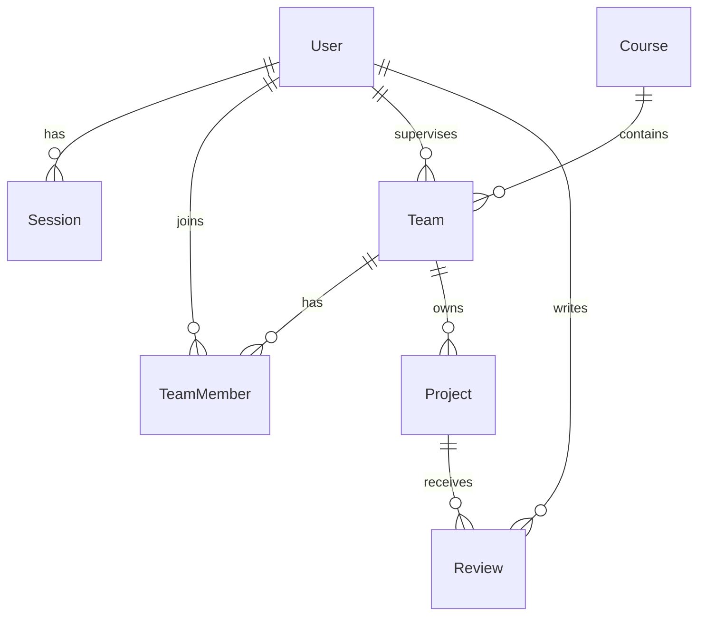

# System-Level SDS

Version 1.0 · 2026-11-06 · Deliverable 1, Part C

## 1. Architecture and stack

```
Browser (React pages, Next.js App Router)
   |  fetch /api/* with session cookie
Route handlers  app/api/**/route.ts   parse request, zod-validate, map result to HTTP
   |
Services        src/services/*.ts     business rules, state machine, authorization
   |
Prisma client   src/db/               typed queries, transactions
   |
PostgreSQL
```

| Component | Responsibility |
|---|---|
| UI | Screens, forms, loading/empty/error states. Never decides authorization; hides controls only for usability. |
| Route handlers | Resolve session user, validate input shape, call one service, translate typed results to status codes and the error envelope. |
| Services | Single place for business rules BR-01 to BR-09 and role/ownership checks. Pure TypeScript over Prisma, unit-testable. |
| Database | Durable state, uniqueness and foreign-key constraints as a second line of defense. |

Rules are enforced in services; the database constraints (unique active project per team, unique membership) back them up. Stack: Next.js, TypeScript, Prisma, PostgreSQL 16, zod, bcryptjs, Vitest, Playwright.

## 2. Data model



| Entity | Fields | Constraints |
|---|---|---|
| User | id, email, name, passwordHash, role (STUDENT, SUPERVISOR, ADMIN), createdAt | email unique, lowercased |
| Session | id (random 32 bytes hex), userId, expiresAt, createdAt | FK User, cascade delete; index on userId |
| Course | id, code, name | code unique |
| Team | id, courseId, name, supervisorId | FK Course, FK User (role SUPERVISOR) |
| TeamMember | teamId, userId, courseId | PK (teamId, userId); unique (userId, courseId) enforces one team per course; max 2 per team enforced in service |
| Project | id, teamId, title, description, status, submittedAt, createdAt, updatedAt | FK Team; partial unique index on teamId where status in (DRAFT, SUBMITTED, REVISION_REQUESTED, APPROVED) |
| Review | id, projectId, supervisorId, decision (APPROVED, REVISION_REQUESTED, REJECTED), feedback (nullable), createdAt | FK Project, FK User; no update or delete path in code |

Ownership: a Project belongs to a Team; a user's access derives from TeamMember (student) or Team.supervisorId (supervisor).

Database setup: `prisma migrate deploy` applies migrations; `prisma db seed` loads synthetic data (1 course, 2 supervisors, 4 students, 2 teams, one project in each of two states). Seed is idempotent (upsert). Seed passwords come from `SEED_PASSWORD` in `.env`, never committed.

## 3. UI conventions

Screens: `/login`; `/projects` (list); `/projects/new`; `/projects/[id]` (detail, edit form for students, review form for supervisors). Unauthenticated page access redirects to `/login`. Top bar shows current user name, role and a Logout button (data from `/api/auth/me`).
Shared behavior: every data screen has a loading indicator, an empty message and an error banner with retry; form fields show per-field errors from the API `fields` map; submit buttons disable while a request is in flight.

## 4. API conventions

- JSON over HTTPS, paths under `/api`, resources plural, actions as sub-resources (`/projects/:id/submit`).
- Success: 200/201 with the resource as JSON. Error envelope: `{ "error": { "code": "NOT_FOUND", "message": "Project not found", "fields": { } } }`. No stack traces or SQL in any message.
- Status mapping (decision D-04): 400 malformed JSON; 401 unauthenticated; 403 role not allowed; 404 record out of scope or missing; 409 rule or state conflict; 422 validation failure.
- Identity comes only from the session cookie. Request bodies never carry userId, teamId of the actor or role.

## 5. Role and permission matrix

| Operation | Anonymous | Student, own team | Student, other team | Supervisor, assigned team | Supervisor, other team |
|---|---|---|---|---|---|
| Login | yes | yes | yes | yes | yes |
| Logout, me | no | yes | yes | yes | yes |
| Create project | no | yes (BR-01) | n/a (team from session) | 403 | 403 |
| Edit project | no | DRAFT or REVISION_REQUESTED | 404 | 403 | 403 |
| Submit project | no | DRAFT or REVISION_REQUESTED | 404 | 403 | 403 |
| Review project | no | 403 | 403 | SUBMITTED only | 404 |
| List projects | 401 | own team's | not shown | assigned teams' | not shown |
| View project detail | 401 | yes | 404 | yes | 404 |

A hidden frontend control is never the enforcement; each row is enforced in the service and tested at the API.

## 6. Authentication and sessions

- Passwords hashed with bcrypt (cost 10 or higher); plain passwords never stored or logged.
- Login verifies the hash, creates a `Session` row with a random 32-byte hex id and 8-hour expiry, and sets cookie `sid` (httpOnly, SameSite=Lax, Secure in production, Path=/).
- Every protected request looks up the session by cookie, rejects missing or expired sessions with 401, and loads the user. `GET /api/auth/me` returns `{id, name, email, role}`.
- Logout deletes the `Session` row and clears the cookie; the old cookie then yields 401.
- Login failure returns the same generic 401 message for unknown email and wrong password.

## 7. Configuration and delivery design

| Variable | Purpose |
|---|---|
| DATABASE_URL | PostgreSQL connection string |
| SESSION_TTL_HOURS | Session lifetime, default 8 |
| SEED_PASSWORD | Password for seeded demo users (local only) |
| NODE_ENV | Enables Secure cookie in production |

`.env` is gitignored; `.env.example` contains placeholders only. No secret appears in client code or the repository.

Planned GCP deployment (Lab 5, not built now): container image in Artifact Registry, run on Cloud Run, database on Cloud SQL for PostgreSQL, `DATABASE_URL` and seed secrets in Secret Manager, migrations run as a release step, CI/CD in GitHub Actions. The app is stateless (sessions in PostgreSQL), reads config from env, and listens on `PORT`, so it packages into a Docker image without code changes.
